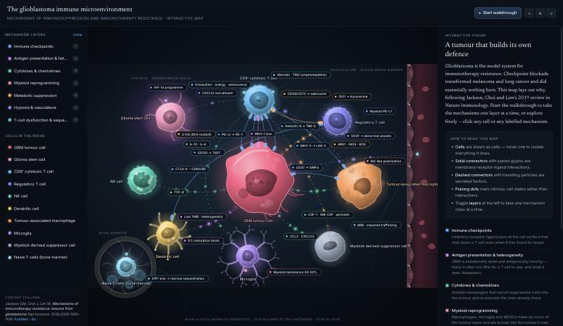

# The glioblastoma immune microenvironment

**Lim Lab · Department of Neurosurgery, Stanford University**

### → **[shreyasannagiri.github.io/gbm-immune-map](https://shreyasannagiri.github.io/gbm-immune-map/)**

An interactive map of immunosuppression and immunotherapy resistance in GBM.

## The source

This figure represents one paper:

> **Jackson CM, Choi J, Lim M.** *Mechanisms of immunotherapy resistance:
> lessons from glioblastoma.* **Nature Immunology.** 2019;20(9):1100–1109.
> [doi:10.1038/s41590-019-0433-y](https://doi.org/10.1038/s41590-019-0433-y)
> · [PMID 31358997](https://pubmed.ncbi.nlm.nih.gov/31358997/)

Every cell, mechanism and claim on the map is drawn from that review. The
figure is an interpretation of it for teaching and discussion and reports no
new data; where the review cites primary work, follow its reference list.

### Citing the figure

> Annagiri S. The glioblastoma immune microenvironment: an interactive map of
> immunosuppression [Internet]. Lim Lab, Department of Neurosurgery, Stanford
> University; 2026. Adapted from Jackson CM, Choi J, Lim M. Mechanisms of
> immunotherapy resistance: lessons from glioblastoma. Nat Immunol.
> 2019;20(9):1100–1109. Available from:
> https://shreyasannagiri.github.io/gbm-immune-map/

The page itself carries a copy-ready version of this, and `CITATION.cff` gives
GitHub's "Cite this repository" button the same information.



## What it shows

Ten cell types in the tumour niche — GBM cell, glioma stem cell, CD8⁺ T cell,
Treg, NK cell, dendritic cell, tumour-associated macrophage, microglia, MDSC
and marrow-sequestered naive T cells — plus a hypoxic/perinecrotic niche, the
vasculature and the bone-marrow compartment.

**26 mechanisms across 7 toggleable layers:**

| Layer | Covers |
| --- | --- |
| Immune checkpoints | PD-1/PD-L1 (tumour and myeloid), CTLA-4, TIM-3, LAG-3, TIGIT, CD47/SIRPα |
| Antigen presentation | MHC-I loss, low TMB and heterogeneity, DC maturation arrest |
| Cytokines & chemokines | TGF-β, IL-10/IL-6, CCL2/CXCL1-2, CSF-1/GM-CSF/periostin |
| Myeloid reprogramming | M2-like polarisation, myeloid dominance of the infiltrate |
| Metabolic suppression | IDO1/kynurenine, ARG1/iNOS/ROS, CD39-CD73/adenosine, 2-HG |
| Hypoxia & vasculature | HIF-1α programme, CXCL12 recruitment, VEGF and abnormal vessels |
| T-cell dysfunction | S1P1 marrow sequestration, steroid/TMZ lymphodepletion, five dysfunction states, BBB trafficking |

Each mechanism opens a panel with a plain-language summary, the molecules
involved, the detail as the review frames it, and the therapeutic angle.

## Reading modes

- **Guided walkthrough** — eight chapters that build the argument one layer at
  a time, from "nothing to see" through to "everything at once".
- **Free exploration** — hover any cell to isolate everything it participates
  in; click any label for the full entry; toggle layers in the left rail.
- **Deep links** — `#m/<mechanism-id>` or `#c/<cell-id>` opens the figure with
  that item selected, e.g. `…/gbm-map/#m/pd1` or `#c/tam`. Useful for linking
  from a paper summary or a teaching page.

## Four ways to run it

**1 · Mac app** — double-click, no terminal, works offline.

```bash
npm run app
```

Builds `desktop/GBM Immune Map.app`. Drag it to Applications or the Dock. It
opens the figure in its own chromeless window (Chrome/Edge/Brave app mode if
one is installed, otherwise the default browser). The whole figure is one HTML
file inside the bundle — about 1 MB, no server, no Node, no network.

**2 · Development** — for editing the science or the design.

```bash
npm install
npm run dev     # http://localhost:5173, hot reload
```

**3 · On the lab website** — a static bundle, no backend.

```bash
npm run build   # dist/ — ~27 kB gzipped, no image assets
```

Asset paths are relative, so `dist/` works from any sub-path. To embed it in
an existing page:

```html
<iframe src="/gbm-map/" title="GBM immune microenvironment"
        style="width:100%;height:820px;border:0"></iframe>
```

**4 · A single file** — for emailing, or for a CMS that takes one upload.

```bash
npm run build:artifact
```

Writes `dist/standalone.html` (complete document, double-clickable) and
`dist/artifact.html` (the same page as a fragment, for publishing platforms
that supply their own document skeleton).

## How it is put together

```
src/
  data/model.js      all scientific content, cell positions, layers, chapters
  render/cells.js    procedural cell anatomy — membranes, nuclei, granules,
                     dendrites, ramified processes, endothelium
  render/scene.js    scene assembly, connector geometry, label de-collision,
                     pan/zoom
  main.js            state, layer filtering, hover isolation, panel, walkthrough
  styles/app.css     layout and visual design
```

**Editing the science.** Everything a reader sees lives in `src/data/model.js`.
Labels place themselves: authored offsets are treated as preferences and a
relaxation pass in `relaxLabels()` keeps pills from colliding with each other
or with cells, for any combination of visible layers.

*To add a mechanism*, append an entry to `MECHANISMS`:

```js
{
  id: 'cd73-tumour',
  layer: 'metabolic',          // one of the LAYERS ids
  kind: 'soluble',             // synapse | soluble | state
  from: 'gbm', to: 'cd8',      // or `at: 'gbm'` for kind: 'state'
  label: 'CD73 → adenosine',   // the pill on the map
  bend: 40,                    // or via: {x, y} to route it by hand
  lab: { dx: 60, dy: -30 },    // label nudge; the solver does the rest
  title: 'Tumour CD73 — …',
  molecules: ['CD73 (NT5E)', 'Adenosine'],
  summary: 'One or two sentences, plain language.',
  detail: 'A paragraph as the source frames it.',
  therapy: 'What this implies for treatment.',
  refs: ['smith2024'],         // omit to credit the primary review
}
```

*To add a paper*, add it to `REFERENCES` in the same file and list its id in
the `refs` array of each mechanism it supports:

```js
smith2024: {
  id: 'smith2024',
  authors: 'Smith AB, Jones CD',
  title: 'Title of the paper',
  journal: 'Nature Medicine', journalAbbrev: 'Nat Med',
  year: 2024, volume: '30', issue: '4', pages: '512–524',
  doi: '10.1038/…', pmid: '12345678',
  doiUrl: 'https://doi.org/10.1038/…',
  pubmed: 'https://pubmed.ncbi.nlm.nih.gov/12345678/',
  short: 'Smith & Jones 2024',
}
```

Each mechanism's panel then shows and links its own sources. Mechanisms with
no `refs` fall back to `PRIMARY_REF`, so nothing existing has to change. If the
figure grows past this one review, update the scope note in the intro panel
and in "The source" above, so the page keeps saying exactly where its content
comes from.

*To add a cell*, append to `CELLS` with a position, radius, colour and one of
the renderer `kind`s in `src/render/cells.js` (`tumor`, `stem`, `lymphocyte`,
`nk`, `macrophage`, `microglia`, `dendritic`, `mdsc`) — or write a new
renderer there if the morphology calls for one.

**The artwork is code.** `render/cells.js` generates each cell from seeded
noise — Catmull-Rom membrane outlines that morph via SMIL, gradient-shaded
nuclei with chromatin and nucleoli, cytoplasmic vesicles, NK granules,
macrophage ruffles and vacuoles, recursive microglial arbors, dendritic
processes, and a flattened endothelial lining with tight junctions. Nothing is
a bitmap, so it stays sharp at any zoom and prints cleanly for posters.

Animation is declarative (SMIL + CSS) rather than JavaScript-driven, so the
figure is cheap to leave running on a page, and `prefers-reduced-motion` is
respected.

## Notes

- `legacy/` holds the previous implementation and its image assets; nothing in
  the current build references it, and it can be deleted at any time.

## Deployment

The site is served by GitHub Pages from this repository. The workflow in
`.github/workflows/deploy.yml` rebuilds and republishes on every push to
`main` — there is no manual deploy step:

```bash
git add -A && git commit -m "describe the change" && git push
```

The live site updates about a minute later. To watch a deploy:

```bash
gh run watch
```

To put the figure on another site (a lab page, a course page), embed it:

```html
<iframe src="https://shreyasannagiri.github.io/gbm-immune-map/"
        title="GBM immune microenvironment"
        style="width:100%;height:820px;border:0"></iframe>
```

Link previews (Slack, iMessage, email) come from the Open Graph tags in
`index.html` and `docs/og.jpg`; regenerate that image if the figure changes
substantially.
